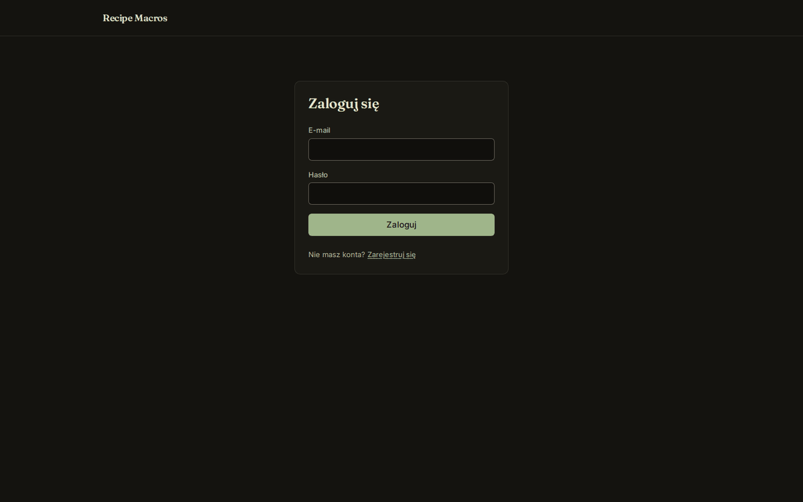
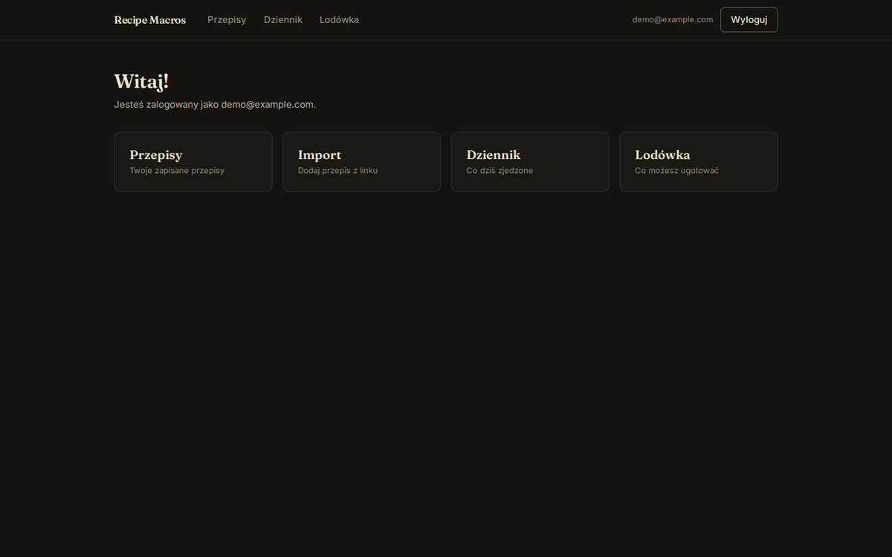
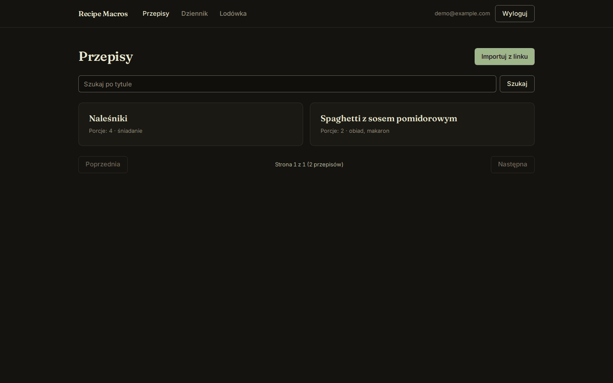
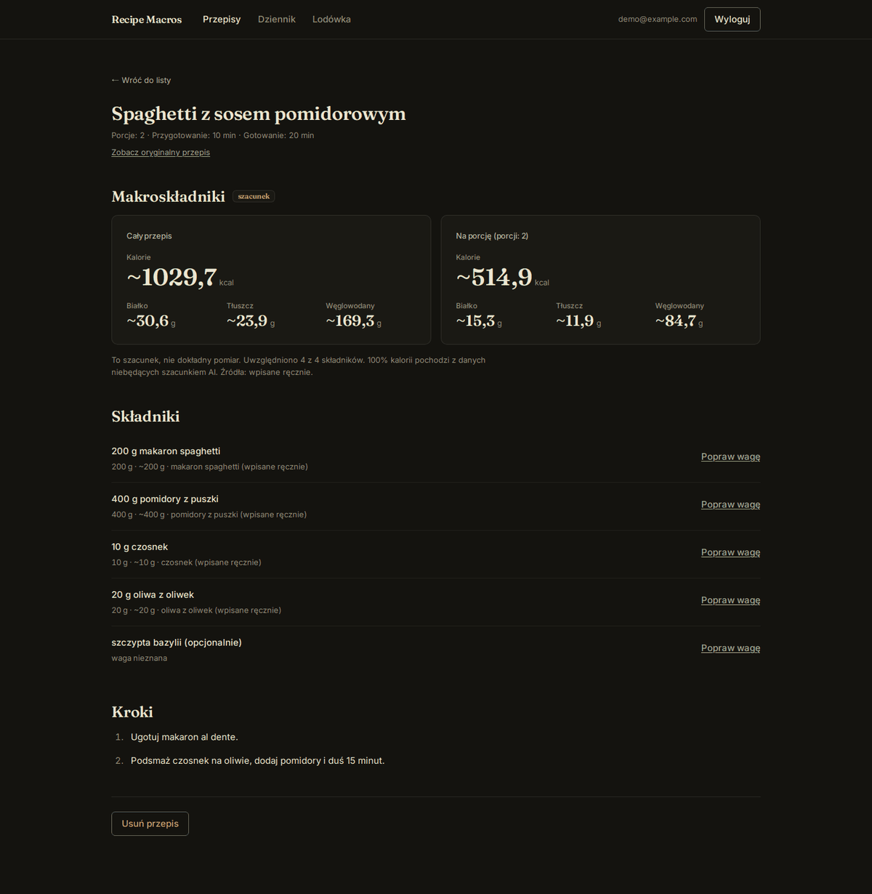
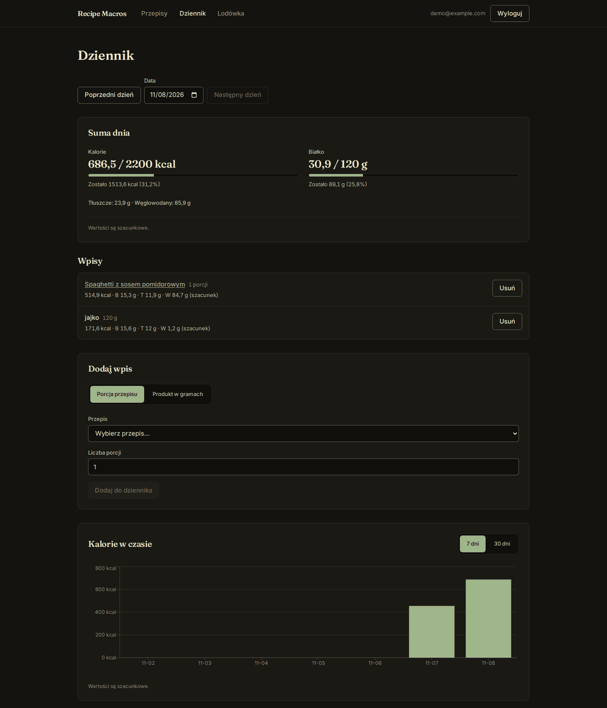
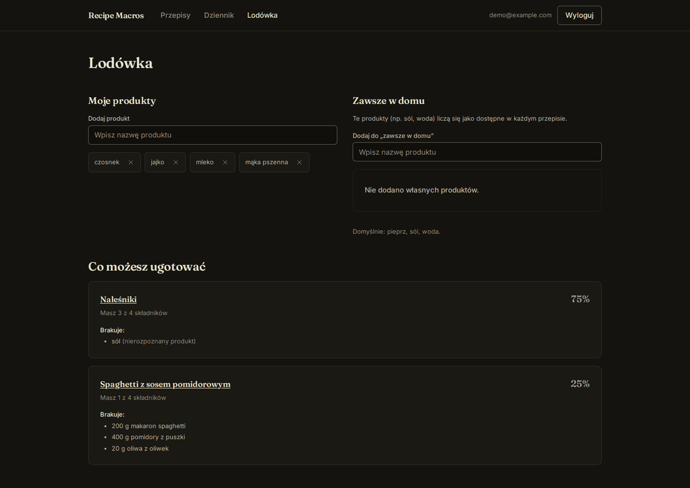
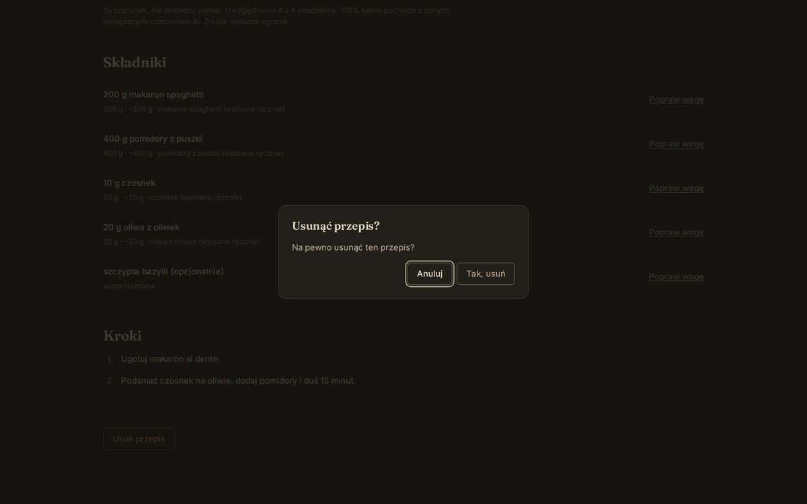
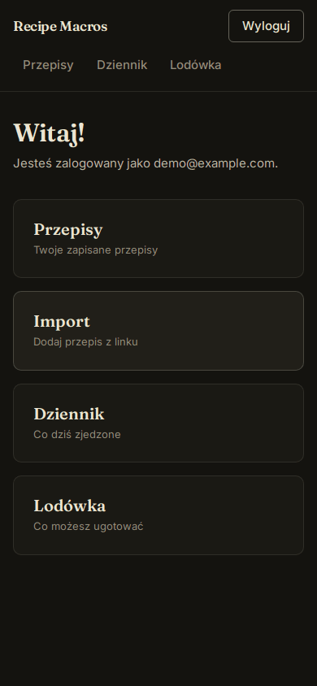
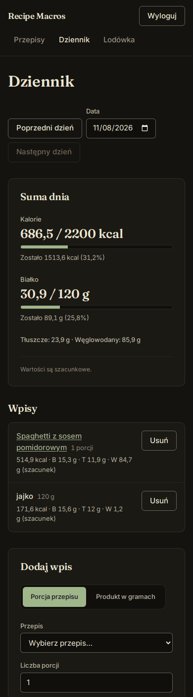

# Recipe Macros

[](https://github.com/RadoslawZimodro/recipe-macros/actions/workflows/ci.yml)

Import a recipe from a link, get an **estimate** of its macros (kcal, protein, fat, carbs; total
and per serving), log what you ate during the day and find recipes that match what is in your
fridge.

> Status: Step 9 in progress (frontend: login and app shell done). See the plan in [AGENTS.md](AGENTS.md).

## Stack

| Layer | Technology |
|---|---|
| Backend | Python 3.12, FastAPI |
| Database | PostgreSQL 18, SQLAlchemy 2 (sync, psycopg 3) + raw SQL, Alembic migrations |
| Cache | Redis 7 |
| Frontend | React 19 + TypeScript (Vite), Tailwind CSS v4, React Router, TanStack Query, Vitest |
| LLM | Anthropic API (backend only) |
| Tooling | Docker Compose, pytest, ruff, pre-commit |

## Running locally

Requirements: Docker Desktop (and git). Everything else runs in containers.

```bash
cp .env.example .env        # optional; empty values fall back to dev defaults
docker compose up --build
```

| Service | URL |
|---|---|
| Frontend | http://localhost:5180 |
| Backend API | http://localhost:8010 (docs: http://localhost:8010/docs) |
| Health check | http://localhost:8010/health |
| PostgreSQL | `localhost:5440` (user/password `postgres` by default) |

Host ports are chosen not to clash with the author's other local projects; all of them can be
changed in `.env` (`DB_HOST_PORT`, `BACKEND_HOST_PORT`, `FRONTEND_HOST_PORT`). With a different
`COMPOSE_PROJECT_NAME` as well, a second stack (e.g. from a git worktree) runs side by side with
its own database volume; the frontend follows the backend port automatically.
Both backend and frontend reload automatically when you edit code.

### Common commands

```bash
docker compose exec backend pytest                                   # tests (own `recipe_macros_test` DB)
docker compose exec backend ruff check . && docker compose exec backend ruff format .
docker compose exec backend alembic upgrade head                     # migrations (also run on startup)
docker compose exec backend alembic revision --autogenerate -m "..."  # new migration
docker compose exec db psql -U postgres -d recipe_macros             # SQL shell
docker compose exec frontend npm test                                # frontend tests (Vitest)
docker compose exec frontend sh -c "npx tsc -b && npm run lint"      # types + lint
```

CI (`.github/workflows/ci.yml`) runs the same commands through `docker compose`: ruff, pytest, `tsc -b`, oxlint, Vitest and the production build.

### Media volume

Recipe step images live in the named volume `media`, mounted at `/app/media` (the path is fixed in
`docker-compose.yml`, not configurable via `.env`). The volume is separate per compose project, survives
`docker compose down`, and is deleted by `docker compose down -v` together with the database.
Because of the `./backend:/app` bind mount, Docker also creates an empty `backend/media/` on the host (git-ignored, expected).

Back up and restore (run from a directory outside the repo; `<project>` is `COMPOSE_PROJECT_NAME`, see `docker volume ls`):

```bash
docker run --rm -v <project>_media:/media:ro -v "$PWD":/backup alpine:3.20 tar czf /backup/media.tgz -C /media .
docker run --rm -v <project>_media:/media -v "$PWD":/backup:ro alpine:3.20 tar xzf /backup/media.tgz -C /media
```

In Git Bash on Windows prefix both commands with `MSYS_NO_PATHCONV=1` and replace `"$PWD"` with `"$(pwd -W)"`.

### Pre-commit (on the host)

```bash
pip install pre-commit   # or: pipx install pre-commit
pre-commit install
```

## Interface

The UI is in Polish and dark only. Screenshots use demo data.

| | |
|---|---|
|  |  |
| Login | Home with shortcuts |
|  |  |
| Recipe list | Recipe detail with estimated macros |
|  |  |
| Day log with totals and calorie chart | Pantry |
|  | |
| Delete confirmation (native `<dialog>`) | |

Mobile:

 

### Design system

A warm, calm "kitchen notebook" look; the full spec is in [.interface-design/system.md](.interface-design/system.md).

- **Dark only**, `color-scheme: dark`, no theme toggle. One accent: sage (`--color-accent`).
- **Type:** Fraunces for headings and the large macro figures, Inter for everything else, both
  self-hosted (`@fontsource-variable`), tabular numerals.
- **Tokens** (colors, radii, fonts) live in `frontend/src/index.css` under Tailwind's `@theme`;
  components use tokens only, no raw hex or palette colors.
- **Flat:** 4 px spacing grid, 1 px hairline borders, no shadows, no gradients.
- **Base components** in `frontend/src/components/ui/`: Button, Input/Select/Field, Card, Chip,
  Modal, Nav, SegmentedControl, MacroFigure, EmptyState, ErrorMessage, Spinner.
- **Accessibility:** text and control borders target WCAG AA contrast, `:focus-visible` rings,
  `prefers-reduced-motion` respected, confirmations use the native `<dialog>` element.

## Frontend

The interface is in Polish (code and comments stay in English) and dark only (see
[Interface](#interface)). It is built in parts, each its own pull request: login and app shell
(done), recipes and import, the day log with a chart, the pantry.

- **Session.** The API keeps the session in HttpOnly cookies, so the browser sends them with
  `credentials: 'include'` and the JavaScript never sees a token. State-changing requests echo the
  readable `csrf_token` cookie into the `X-CSRF-Token` header (double-submit CSRF).
- **Silent refresh.** The access token lives 15 minutes. On a `401` the client calls
  `/auth/refresh` once, with a single refresh in flight at a time (two parallel refreshes would
  look like a replayed token to the server), and repeats the request. Only if that fails is the
  user logged out and the cache cleared, so one user's data is never shown to the next. The login
  and `/auth/me` requests are exempt: for them a `401` is an answer, not an expired session.
- **Data.** TanStack Query for server state (`/auth/me` decides who is logged in); no global store.
- **Messages.** The API's errors are English; `describeError` turns the common statuses into Polish
  and appends the API's own detail only where it is specific (for example the password rule).
- **Recipes.** `/recipes` (search, paging), `/recipes/import` (import from a link; it can take
  tens of seconds, so the form shows progress, and the API's stable error codes become Polish
  messages, e.g. for Instagram/TikTok/YouTube) and `/recipes/:id` (ingredients, steps, link to
  the original, macros total and per serving always labelled "szacunek" with the data sources,
  manual correction of an ingredient's weight, delete).
- **Cooking mode.** "Tryb gotowania" on `/recipes/:id` (disabled without steps) opens a native
  modal `<dialog>` (full screen on a phone) with one step at a time: "Krok 3 z 8", a progress bar,
  the step photo if there is one, Wstecz / Dalej / Zakończ, numbered buttons to jump, and a collapsed
  "Składniki" panel. Arrow keys change the step, Escape or a click on the backdrop closes it, page
  scrolling is locked and focus returns to the opening button. A photo that fails to load is hidden
  and the step shows without it; the next photo is preloaded.
  Step photos: the API returns `image_url` relative to itself (`/recipes/12/steps/3/image`); the
  frontend prefixes `VITE_API_URL`, the same base as every API call. The app and the API differ
  only by port (`localhost:5180` / `localhost:8010`), which is the same site, so the browser sends
  the HttpOnly session cookies with the `` request and no Vite proxy is needed. Serving the
  app and the API from different sites (other hostnames) would break photos.
- **Pantry.** `/pantry` lets you add products through a search box (`GET /ingredients?q=`), mark
  products as always at home (`/staples`) and shows recipes sorted by how many required
  ingredients you have, with the missing lines and a link to the recipe.
- **Tests.** Vitest + Testing Library with a mocked `fetch`: the client (CSRF header, refresh,
  no loops, error parsing) and the login/register flows (wrong password, taken email, redirects).
- **Day log (`/log`).** Pick a date, add servings of a recipe or grams of a product (search by name),
  delete entries, see the day's total against the goals (editable here) and a 7/30-day calorie chart
  (Recharts). Days follow Polish time like the API; all macros are shown as estimates.

## Authentication

Email + password accounts, no email confirmation. Interactive docs: http://localhost:8010/docs.

| Endpoint | Purpose |
|---|---|
| `POST /auth/register` | Create an account and start a session (`409` if the email is taken) |
| `POST /auth/login` | Verify credentials and start a session (rate limited per IP) |
| `POST /auth/refresh` | Rotate the refresh token, issue a new access token |
| `POST /auth/logout` | Revoke the refresh token and clear cookies |
| `GET /auth/me` | Current user, with the daily goals; `401` without a valid session |
| `PATCH /auth/me/goals` | Set or clear the daily kcal / protein goals (`null` clears one) |

Design decisions:

- **Argon2id** password hashes (memory-hard, no 72-byte limit like bcrypt).
- **Short-lived access JWT (15 min, HS256) + opaque refresh token (6 h)**, both in `HttpOnly`
  cookies, so JavaScript can never read them (XSS cannot steal a session). The refresh cookie is
  scoped to `/auth`, so it is not sent with ordinary API calls.
- **Refresh rotation with reuse detection**: every refresh revokes the old token and links it to
  its successor (`refresh_tokens.replaced_by_id`). Replaying an already-rotated token revokes the
  user's whole token chain. Only the sha256 of a refresh token is stored. Rotation locks the row
  (`SELECT ... FOR UPDATE`), so two concurrent refreshes cannot both succeed.
- **CSRF**: double-submit cookie. State-changing endpoints depend on `require_csrf`, which compares
  the `csrf_token` cookie with the `X-CSRF-Token` header in constant time. `SameSite=Lax` is the
  second layer.
- **Data isolation**: the user id is taken only from the verified token (`get_current_user`),
  never from the request body, query or path.
- **Login hardening**: identical error for unknown email and wrong password, a dummy hash check
  keeps timing constant, and an in-memory per-IP limiter returns `429`. The limiter is
  process-local (single uvicorn worker); move it to Redis before scaling out.
- Emails are lowercased by the API and by a `CHECK (email = lower(email))` constraint in
  PostgreSQL, so `UNIQUE(email)` is effectively case-insensitive.

## Recipes API

Everything below needs a session; `POST`/`PUT`/`DELETE` also need the `X-CSRF-Token` header.

| Endpoint | Purpose |
|---|---|
| `POST /recipes` | Create a recipe with its steps and ingredient lines (`201`; `409` if the same `source_url` is already saved) |
| `GET /recipes?q=&tag=&limit=&offset=` | Page of recipes, newest first; `q` searches the title (substring + typos), `tag` filters |
| `GET /recipes/{id}` | One recipe with ordered steps and ingredient lines |
| `PUT /recipes/{id}` | Replace the whole recipe; steps and lines are replaced as a unit in one transaction |
| `DELETE /recipes/{id}` | Soft delete (`204`) |
| `GET /ingredients?q=` | Search products: the shared catalog plus your own |
| `POST /ingredients` | Add a private product (nutrition per 100 g, `source` is always `manual`) |
| `GET /units` | Allowed units for ingredient lines |
| `PATCH /ingredients/{id}` | Correct one of your own products (macros, density, name); it becomes `source = manual` |
| `GET /recipes/{id}/nutrition` | Macronutrients of a recipe, total and per serving, with coverage and sources (see "Macronutrients") |
| `PATCH /recipes/{id}/ingredients/{line_id}` | Correct one ingredient line: type in its weight in grams and/or change its product |
| `POST /recipes/import` | Import a recipe from a link (see below) |
| `GET /recipes/{id}/steps/{position}/image` | The saved picture of a step (`404` if none or not yours); see "Step pictures" |

Other users' recipes return `404`, not `403`, so their existence is not revealed.
Nutrition values are estimates and carry a `source` (`usda`, `manual`, `llm_estimate`).

## Food log

The user records what they ate and the API sums up the day and compares it with the goals
(`PATCH /auth/me/goals`: `daily_kcal_goal` 500-10000, `daily_protein_goal` 1-1000, both optional).

| Endpoint | Purpose |
|---|---|
| `POST /food-log` | Record `{"recipe_id", "servings"}` **or** `{"ingredient_id", "grams"}` (exactly one kind), optionally `logged_at` (with a time zone; default now) |
| `GET /food-log?date=2026-03-11` | Entries of one day, the day's totals and the comparison with the goals (default: today) |
| `GET /food-log/days?from=...&to=...` | Totals per day for up to 366 days, days without entries included (for a chart) |
| `DELETE /food-log/{id}` | Remove an entry |

```json
{
  "timezone": "Europe/Warsaw",
  "totals": {
    "day": "2026-03-11", "entries": 1, "is_estimate": false, "complete": true,
    "total":   {"kcal": 540.0, "protein": 10.5, "fat": 1.5, "carbs": 120.0},
    "kcal":    {"goal": 2000, "eaten": 540.0, "remaining": 1460.0, "percent": 27.0},
    "protein": {"goal": 100,  "eaten": 10.5,  "remaining": 89.5,   "percent": 10.5}
  },
  "entries": [{"id": 4, "kind": "product", "name": "ryż", "grams": 150.0, "complete": true,
               "nutrition": {"kcal": 540.0, "protein": 10.5, "fat": 1.5, "carbs": 120.0}}]
}
```

Decisions, each with its reason:

- **Only the fact is stored, never the macros.** A row says "recipe 5, 2 servings" or "product 7,
  150 g"; the view `food_log_nutrition` works the numbers out on every read from the recipe and
  product data of the moment. A corrected line weight or product therefore corrects the history as
  well (same idea as the recipe nutrition). A soft-deleted recipe keeps counting. The price: an
  old day changes when the data behind it changes.
- **Exactly one kind of entry** is a `CHECK` constraint (`ck_food_logs_exactly_one_source`), not
  only an API rule: no insert, whoever makes it, can store both or neither.
- **A "day" is a calendar day in Polish time**, not in UTC. Timestamps are `timestamptz` (an
  instant); an entry at 00:30 Polish time is the new day although it is still the previous evening
  in UTC. The time zone rules, including summer time, come from PostgreSQL (`AT TIME ZONE`).
- **The day filter compares `logged_at` with the day's boundaries** instead of casting it to a date,
  so the index `(user_id, logged_at)` serves it as a range scan:

```sql
WHERE n.logged_at >= CAST(b.d_from AS timestamp) AT TIME ZONE :tz
  AND n.logged_at <  CAST(b.d_to + 1 AS timestamp) AT TIME ZONE :tz
```

- **Days without entries come from `generate_series`**, and the totals are joined to that series
  (`food_log_days.sql`, a CTE): a chart needs the empty days, a plain `GROUP BY` would drop them.
- **Row-Level Security with an extra check.** Besides `user_id = app_current_user_id()`, the policy's
  `WITH CHECK` demands that the recipe / product is visible to the user, because a foreign key alone
  would accept someone else's private id (tested with raw SQL as `app_user`).
- **Honest numbers.** An entry says whether it `is_estimate` (some part is an AI guess) and whether it
  is `complete`; a recipe whose lines could not all be computed counts what is known and is flagged,
  and one where nothing can be computed has `nutrition: null` rather than a false zero.
  Rounding is .x5 up, as on a label; day totals are rounded after summing, so the rounded entries
  may differ from the total by 0.1.

## Pantry

"What can I cook with what I have?" The user lists the products they have and gets their recipes
sorted by the share of ingredients they already own, with what is missing.

| Endpoint | Purpose |
|---|---|
| `PUT /pantry/{ingredient_id}` / `DELETE /pantry/{ingredient_id}` | Put a product in the pantry / take it out (adding is idempotent) |
| `GET /pantry` | The products the user has |
| `GET /staples` | "Always at home": the default names (water, salt, pepper) and the user's own |
| `PUT /staples/{ingredient_id}` / `DELETE ...` | Mark / unmark one of your own products as always at home |
| `GET /pantry/recipes?min_percent=0&limit=20` | Recipes, best match first |

```json
[
  {"recipe_id": 3, "title": "Naleśniki", "lines_total": 4, "lines_have": 4, "percent": 100.0, "missing": []},
  {"recipe_id": 5, "title": "Placki", "lines_total": 4, "lines_have": 2, "percent": 50.0,
   "missing": [{"line_id": 17, "raw_text": "100 g masła", "unlinked": false},
               {"line_id": 18, "raw_text": "1 łyżka cukru", "unlinked": false}]}
]
```

How the match is decided (all of it in one query, [`pantry_match.sql`](backend/app/sql/pantry_match.sql)):

- **By product name, not by id.** A required line counts as available when its product has the same
  name (case-insensitive) as a product in the pantry, in the user's staples, or in the default list.
  The user's own "mąka" and the catalog's "mąka" are therefore the same flour, as in the nutrition view.
- **Optional lines are left out** of the percentage. A recipe with no required lines is not listed.
- **A line without a linked product counts as missing** and is marked `unlinked`: it can never match,
  and ignoring it would make a half-understood recipe look perfect.
- **Staples never count as missing.** The default names live in the table `default_staples` (names,
  not ids, because recipes are matched by name and the catalog may lack one of them). The user adds
  their own (oil, sugar) to `staple_ingredients`. An empty pantry therefore still matches the salt.
- **Ties** are broken by the number of missing ingredients (fewer first), then by title.

The query is a chain of CTEs: `have` (a `UNION` of the three lists into a set of names),
`required_lines` (recipe lines joined with the products and the set), and `scored`, which aggregates
per recipe with `count(*) FILTER (WHERE ...)` and builds the list of missing lines with
`jsonb_agg(...) FILTER (WHERE NOT have_it)`:

```sql
count(*) FILTER (WHERE have_it) AS lines_have,
jsonb_agg(jsonb_build_object('line_id', line_id, 'raw_text', raw_text, 'unlinked', unlinked)
          ORDER BY position) FILTER (WHERE NOT have_it) AS missing
```

**`EXPLAIN (ANALYZE)` on synthetic data** (2000 recipes with 8 lines each, 7 of them required, 15
products in the pantry; run as `app_user`, so Row-Level Security filters are part of the plan; the
data was rolled back afterwards):

```
Limit (actual rows=20)
  -> Sort (top-N heapsort, Memory: 46kB)
       -> GroupAggregate  Group Key: r.id (actual rows=2000)
            -> Sort  Sort Key: r.id (14000 rows, quicksort, 1196kB)
                 -> Hash Left Join  (lower(i.canonical_name) = lower(i_1.canonical_name))
                      -> Hash Left Join  (ri.ingredient_id = i.id)
                           -> Hash Join  (ri.recipe_id = r.id)
                                -> Seq Scan on recipe_ingredients ri  (Filter: NOT is_optional AND user_id = ...)
                                -> Hash <- Seq Scan on recipes r      (Filter: deleted_at IS NULL AND user_id = ...)
                           -> Hash <- Seq Scan on ingredients i
                      -> Hash <- HashAggregate (the `have` set: 16 names)
Execution Time: 57.8 ms   (everything in memory: shared hit=169)
```

What to say about it: every recipe has to be scored, so the user's recipe lines are read once
whatever indexes exist; the planner hashes the small tables (products, the set of names the user has) and
joins them in a single pass, which is linear in the number of lines (about 14,000 lines in 58 ms).
The only index used is the unique index on `staple_ingredients (user_id, ingredient_id)`, which also
enforces "one row per product". `LIMIT` only saves sorting, not reading, because the order depends on
the score of every recipe. If the numbers grew by orders of magnitude the next step would be
precomputing the names of each recipe's required lines, not another index.

Both lists are protected like the food log: Row-Level Security on `user_id`, with a `WITH CHECK`
that the product is visible to the user (a foreign key alone would accept someone else's private id).
Substitutes (butter for margarine) are intentionally left for later.

## Import from a link

`POST /recipes/import` with `{"url": "...", "refresh": false}` fetches a recipe page and saves it as a
normal recipe, keeping a link to the original in `source_url`. The page is read in two stages: its
own markup (schema.org JSON-LD, or Microdata when JSON-LD has no usable recipe) is read by plain
code, and **the AI then shapes the result** (see "AI import" below). Recipes the AI shaped have
`import_method = llm`; if the AI was not available they keep `jsonld` / `microdata`.

| Result | Meaning |
|---|---|
| `201 {"status": "created"}` | New recipe saved |
| `200 {"status": "existing"}` | You already have it; nothing was fetched (your edits are safe) |
| `200 {"status": "refreshed"}` | `refresh: true`: page fetched again, recipe overwritten in place (manual edits are lost) |
| `422/429/502/503/504` | `{"detail": {"code": ..., "message": ...}}` with a stable `code` such as `robots_disallowed`, `blocked_address`, `unsupported_site`, `no_recipe_data`, `access_denied`, `rate_limited`, `ai_unavailable`, `ai_invalid_output` |

Every successful answer also says `"ai_used": true|false` and, when the AI could not be used, a
`"notice"` that explains why.

Try the pipeline on any address without saving anything (`--ai` shows the AI's reading of every
ingredient line, so you can judge its quality on real pages; it calls the paid API):

```bash
docker compose exec backend python -m app.scripts.fetch_recipe "https://example.com/some-recipe" --ai
```

How a page is fetched (`app/services/safe_fetch.py`, `page_fetcher.py`, `robots.py`):

- **SSRF protection.** A user-supplied address must never make the server call its own network.
  The host name is resolved by us and rejected unless *every* address is public (loopback, private,
  link-local, cloud metadata `169.254.169.254`, CGNAT, multicast, IPv4-mapped/NAT64/6to4 IPv6 and
  odd literals like `2130706433` are all refused). The connection then goes to the **IP we checked**
  (the URL is rewritten to the IP; the name stays in the `Host` header and is used for TLS
  verification), so DNS cannot answer differently between check and connect (DNS rebinding).
- **Redirects** are never followed by the HTTP library: each hop is validated and resolved again (max 5).
  Proxy settings from the environment are ignored, since a proxy would bypass the pinned IP.
- **Limits:** only `http(s)` on ports 80/443, no credentials in the URL, HTML only, 2 MB measured
  *after* decompression (gzip bombs), connect 5 s / read 10 s / 15 s in total.
- **robots.txt** per RFC 9309 with a small parser of our own (`urllib.robotparser` ignores the `*`
  and `$` wildcards): a missing file allows, a disallow refuses, an unreachable one (5xx, network) is
  treated as a disallow. Rules are cached for 24 h (10 min when unreachable).
- **Politeness:** identifies itself as `RecipeMacrosBot/0.1 (+repo URL)`, no cookies, at most 10
  imports per minute per user (a Redis counter that works across workers), YouTube/Instagram/TikTok
  links are refused with a clear message, pages behind a login or paywall (401/402/403) are not bypassed.
- **Cache.** The fetched HTML is stored compressed in Redis for 24 h, keyed by the normalized URL, so
  re-parsing or the AI step does not hit the site again. Redis being down never breaks an import.
- **Microdata** (`app/services/microdata.py`) is converted into the same dictionary shape as JSON-LD, so
  one mapping handles both. It follows the HTML Microdata rules: properties of a nested item (an
  author's `name`, a review's text) never leak into the recipe, values come from the right
  attribute (`content` of `<meta>`, `src` of ``, `datetime` of `<time>`, `href` of `<a>`/`<link>`),
  `itemref` pulls in properties defined elsewhere, and block elements (not inline tags like `<b>`)
  separate steps. JSON-LD wins when both formats carry a recipe.
- **URL normalization** (`source_url`, upsert key, cache key): host in lower case, default port and
  `#fragment` dropped, tracking parameters (`utm_*`, `fbclid`, `gclid`, ...) removed.

The save is one SQL statement, an upsert on the partial unique index
([`upsert_imported_recipe.sql`](backend/app/sql/upsert_imported_recipe.sql)):

```sql
INSERT INTO recipes (user_id, title, source_url, ..., import_method, imported_at)
VALUES (:user_id, :title, :source_url, ..., :import_method, now())
ON CONFLICT (user_id, source_url) WHERE source_url IS NOT NULL AND deleted_at IS NULL
DO UPDATE SET title = EXCLUDED.title, ..., imported_at = EXCLUDED.imported_at
RETURNING id, (xmax = 0) AS inserted;   -- xmax <> 0 means an existing row was updated
```

### Step pictures

If a step in the page's JSON-LD / Microdata has an `image` (a URL, an `ImageObject` or a list;
relative links are resolved against the page, anything but `http(s)` is ignored), the import saves
a **local copy**. Each step in the API answer has `image_url`: `null`, or the relative address
`/recipes/{id}/steps/{position}/image` of our own endpoint. That endpoint needs a session, answers
with the stored `Content-Type`, `X-Content-Type-Options: nosniff` and
`Cache-Control: private, max-age=86400`; a recipe that is not yours returns `404`. Clients can
never send `image_url` (the step body of `POST`/`PUT` has only `instruction`), so no URL or path can
be injected.

- **Download.** Through the same SSRF-safe fetcher as pages (pinned IP, redirects re-validated), but
  with its own limits: 5 MB per file (after decompression), 30 pictures per recipe, the usual
  connect/read timeouts, and a hard 60 s ceiling for the whole picture phase: each download gets only
  the time that is left (never more than the normal 15 s), and pictures still waiting when the time runs
  out are skipped and counted in the `notice`. robots.txt is not consulted again for pictures (the page itself was
  allowed).
- **Type by content.** The first bytes decide (JPEG, PNG, WebP, GIF), not the `Content-Type` header or
  the extension, so an SVG (which can carry scripts) or an HTML file renamed to `.jpg` is rejected.
- **Names.** Files are saved as `<uuid hex>.<ext>` in `MEDIA_DIR` (in compose it is
  `/app/media`, the `media` volume, see "Media volume"; the code's default `/media` is only a fallback
  when running outside compose); the name never comes from a URL, so there is no path traversal. The database
  stores only that name and a CHECK constraint enforces its shape.
- **Schema.** Two nullable columns on `recipe_steps` (a step has at most one picture) instead of a new
  table: the existing Row-Level Security policy and the composite foreign key to the recipe apply
  as they are.
- **A bad picture never breaks an import.** Failure, timeout, rejection or a limit only leaves that
  step without a picture; the answer's `notice` says how many were skipped.
- **AI keeps pictures only when it is safe.** The AI may merge or split steps. If the number of steps
  after the AI differs from the number on the page, no pictures are attached: no picture is better
  than a picture on the wrong step.
- **Files follow the database.** `refresh` replaces the pictures and deletes the old files; a failed
  save deletes the new files. `PUT /recipes/{id}` keeps a picture only for a step that has the same
  position *and* the same text as before; other pictures are removed together with their files.
  `refresh` follows the same rule: a step whose new picture failed to download (or that has none now)
  keeps its old picture while its position and text are unchanged.
  Soft delete leaves the files (the recipe can still be referenced by the food log).

## AI import

The AI (Claude, `claude-haiku-5-5` by default, change it with `AI_MODEL`) is called from the backend
only, with **one request per import**. Its answer is forced into a JSON schema (structured outputs
through `messages.parse` with Pydantic models), so it cannot come back in another shape. It has no
tools and no access to the database or the internet, so text hidden in a web page can at most make
it return a wrong answer, which is then rejected.

| Page | What the AI gets | What it returns |
|---|---|---|
| Has markup (JSON-LD / Microdata) | the ingredient lines and steps from the markup | every ingredient line taken apart (quantity, unit from our `units` table, product, optional flag, estimated nutrition per 100 g) and tidied steps |
| No markup | the cleaned text of the page (menus, scripts, footers removed; max 30 000 characters, cut around the "Ingredients" heading) | the whole recipe (title, servings, times, tags, steps, ingredient lines) |

Title, description, servings, times, tags and image of a page **with** markup stay exactly as the
site published them; only the steps and ingredient lines go through the AI. Ingredient text
(`raw_text`) always stays the original wording.

**Products.** For every product the AI names, the catalog is searched in one query
([`match_products.sql`](backend/app/sql/match_products.sql), a `LATERAL` join over `unnest`): the
exact name first, then a very similar one (`pg_trgm` similarity >= 0.8, and the digits in the two
names must be identical, because "mleko 2%" and "mleko 3,2%" score exactly 0.80 and are different
products). The user's own product shadows a shared one. Anything else becomes a **private product with
`source = 'llm_estimate'`**; the AI never writes to the shared catalog. If the AI's numbers are not
believable (out of range, more than 100 g of nutrients in 100 g, calories far from 4/4/9 kcal per
gram) the product is not created and the line stays unlinked, with its quantity and unit.

**Checks on the answer.** The shape is guaranteed by the schema; the meaning is checked in code
(`validate_*` in [`ai_extract.py`](backend/app/services/ai_extract.py)): one entry per ingredient line,
steps present, quantities in range, ingredient lines of a whole-page reading must be *found on the
page* (an invented ingredient is caught), and pounds/ounces must be converted (a real test on a real
page once returned "1 pound" as `1 g`). A wrong answer gets **one correction attempt** that names the
problems; a second failure ends the import with `ai_invalid_output` and nothing is saved.

**Cost control.**

- Answers are cached in Redis for 7 days, keyed by model, prompt version and the exact input; only
  validated answers are cached, and a refresh of an unchanged page costs nothing.
- Each user has a daily allowance of AI imports (20); cache hits do not count.
- Every API call is logged (model, mode, tokens, request id) and counted in Redis per day:
  `redis-cli get ai:calls:<YYYY-MM-DD>`, `ai:input_tokens:<day>`, `ai:output_tokens:<day>`.
- Measured on real pages with Haiku: about **0.2 cents per import**.

**When the AI is not available** (no key, invalid key, no credit, rate limit, outage, daily limit)
a page with markup is still imported in its basic form (ingredients as plain text, `ai_used: false`
and a `notice`), and can be upgraded later with `refresh: true`. A page without markup cannot be
imported without the AI (`ai_unavailable`, or `no_recipe_data` when no key is configured).

**Measured on real pages** (Polish and English, via the `--ai` script): ingredient lines are taken
apart correctly (units, fractions, ranges, countable items such as "2 żółtka"), a page whose markup
put the *whole article* into the steps (52 lines) came out as 8 clean steps, pages with no usable
markup (Kwestia Smaku, Słodki Pomysł) are read from their text, and imperial units are converted
(`2 (28-ounce) cans` -> 1588 g). The design is deliberately the minimal one (a single request); if
quality on more pages turns out to be too low, the next step is a second request that lets the AI
choose the product from a list of candidates from the catalog.

**Tested on real sites** (read-only, nothing stored in the repo; tests use synthetic pages written
for them): works on Kuchnia Doroty, Kuchnia Lidla and Ania Gotuje (Microdata) in Polish, and on The
Modern Proper, Once Upon a Chef and The Daily Meal in English.

**Known limitations**

- Without the AI, pages whose markup is incomplete (some blogs mark up only the title, picture and
  rating) cannot be imported. Some sites (for example przepisy.pl) refuse automated clients with
  `403`; this is reported, never circumvented.
- AI output is an estimate. Nutrition values are the model's guess for a typical product (always
  `source = llm_estimate`), quantities of "to taste" lines stay empty, and a unit that is not in the
  dictionary is converted to metric or left empty. A cup is 250 ml everywhere (see "Macronutrients").
- Text a site gets wrong stays wrong: a typo in a site's own steps is copied faithfully.
- A product the shared catalog does not know starts as a private AI estimate. The shared catalog is
  filled from the USDA data (see "Macronutrients"); recipes pick up the measured product by themselves.
- A host name is resolved with the operating system's resolver, which has no timeout of its own
  (the 15 s budget applies from the first connection).

## Macronutrients

`GET /recipes/{id}/nutrition?include_optional=false` returns the calories, protein, fat and
carbohydrates of a recipe, in total and per serving. **It is always an estimate** (`"is_estimate":
true`), and the answer says how good the estimate is instead of pretending to precision:

```json
{
  "recipe_id": 12, "servings": 4, "is_estimate": true,
  "total":       {"kcal": 3171.3, "protein": 47.1, "fat": 216.0, "carbs": 265.0},
  "per_serving": {"kcal": 792.8,  "protein": 11.8, "fat": 54.0,  "carbs": 66.3},
  "coverage": {"lines_total": 8, "lines_counted": 5, "percent": 62.5},
  "measured_share": 1.0,
  "lines": [
    {"raw_text": "2 łyżki miodu", "grams": 42.6, "weight_source": "density", "is_estimate": false,
     "product": {"id": 3, "name": "miód", "source": "usda"},
     "nutrition": {"kcal": 129.5, "protein": 0.1, "fat": 0.0, "carbs": 35.1}, "problem": null}
  ],
  "missing": [
    {"raw_text": "1 szklanka mleka", "problem": "no_density",
     "message": "the weight of a spoon or glass of this product is unknown (no density)"}
  ]
}
```

- `coverage`: how many lines could be computed. Lines that cannot be (no amount, no product, no
  known weight of a spoon or a piece) are **listed in `missing` with the reason, never guessed**; the
  total is "what we know". Optional lines are left out unless `include_optional=true`.
- `measured_share`: the share of the calories that rests on data that is **not** an AI guess
  (USDA or typed in by the user). Every line also says whether it is an estimate.
- Per serving is the total divided by the number of servings. Weights are those of the raw
  ingredients (cooking, evaporation and oil absorption are not modelled). Values are rounded to
  0.1, with .x5 rounded up like on a nutrition label.

**How a line gets its weight** (all in SQL, see below):

| Unit | Weight |
|---|---|
| a weight typed in by the user (`grams` on the line) | exactly that, always first |
| `g`, `kg` | amount x 1 or 1000 |
| `ml`, `l`, `tsp` (5 ml), `tbsp` (15 ml), `cup` (250 ml) | ml x **density** of the product (honey is not flour) |
| `piece`, `clove`, `slice`, `pinch` | amount x the **weight of one** such unit of the product (an egg 55 g, a clove 5 g); a pinch is 0.5 g by default |

Densities and piece weights live in `ingredients.density_g_per_ml` and the `unit_conversions` table,
with the same visibility rules as products (shared rows, or the user's own that win over them). A cup
is 250 ml everywhere; for American recipes (240 ml) that is about 4% too much.

**Where the numbers are worked out.** In the database, on every read, so a corrected product or a new
catalog entry changes the result at once and nothing has to be refreshed. The view
[`recipe_line_nutrition`](backend/migrations/versions/0006_nutrition_conversions_and_view.py) joins each
ingredient line with its product and conversions, and a query sums it
([`recipe_nutrition.sql`](backend/app/sql/recipe_nutrition.sql)):

```sql
SELECT count(*)                                                  AS lines_total,
       count(*) FILTER (WHERE l.kcal IS NOT NULL)                AS lines_counted,
       COALESCE(sum(l.kcal), 0)                                  AS kcal,
       COALESCE(sum(l.kcal) FILTER (WHERE NOT l.is_estimate), 0) AS kcal_measured
FROM recipe_line_nutrition l
WHERE l.recipe_id = :recipe_id AND (:include_optional OR NOT l.is_optional);
```

The view is created `WITH (security_invoker = true)`. A normal view runs with the rights of its owner,
which would bypass Row-Level Security and show every user's recipes; with `security_invoker` it runs
as the caller, so RLS still applies (`tests/test_nutrition.py` checks this as the restricted role).

**Which product is used.** For a line linked to a product, the view takes the best visible product with
the same name: **the user's own manual entry first, then the shared (measured) one, then the user's
own AI estimate.** An old AI guess therefore never hides measured data, and recipes imported earlier
improve by themselves when the shared catalog grows. The same order is used when the AI names a
product during an import.

**Manual corrections** (nothing shared is ever modified):

- `PATCH /recipes/{id}/ingredients/{line_id}` with `{"grams": 250}` and/or `{"ingredient_id": 7}`
  (`null` clears the value). A typed-in weight survives when the client sends the recipe back with `PUT`.
- `PATCH /ingredients/{id}` edits one of the user's own products; the result is marked `manual`.
  Shared products answer `403` with a hint to add a product of the same name (which takes precedence).

**Measured data from the USDA.** A recipe says "flour", not a brand, so the shared catalog is built from
generic foods. The [USDA FoodData Central](https://fdc.nal.usda.gov) publishes laboratory measurements of
generic foods: Foundation Foods (about 400 foods) and SR Legacy (about 7800 foods, with the weight of a
cup or a piece). The script loads a **raw copy** into the `usda_*` staging tables and does not touch the
shared catalog; the catalog receives only products mapped to our own names, in a separate step.

```bash
docker compose exec backend python -m app.scripts.import_usda   # downloads about 10 MB, takes seconds
```

It reads the CSV straight out of the ZIP files, writes with `COPY` and replaces the tables in one
transaction (a failure keeps the old data, running it again is safe). USDA stores nutrients as one row per
(food, nutrient); the view `usda_food_macros` turns that into one row per food. Energy comes from
nutrient 1008, and when a food has none (most Foundation foods) from the Atwater factors 2047, then 2048.
The Foundation release of 2026-10-29 is published without its main tables, so the last complete release
(2025-12-18) is pinned. Some Foundation foods have no carbohydrate value (nutrient 1005) and stay `NULL`.
The USDA data is in the public domain (CC0). USDA values are stored with `source = 'usda'` and shown as
measured, not as an estimate.
The database constraint still allows the older value `off` (rows imported earlier from Open Food Facts);
no code writes it any more.

**Filling the catalog from USDA.** The staging tables hold 8000 English names; the shared catalog should hold
our own, Polish ones. [`usda_mapping.csv`](backend/app/data/usda_mapping.csv) says which USDA food stands for
each ingredient of the starter list (a reviewable file, chosen by hand, not guessed at run time). The script
writes the macros per 100 g of the mapped food as `source = 'usda'`, together with the densities and piece
weights of the starter list (USDA has no density, and its portion weights differ per food). Rows that are
already in the catalog are updated, not duplicated:

```bash
docker compose exec backend python -m app.scripts.import_usda_catalog --dry-run   # look first
docker compose exec backend python -m app.scripts.import_usda_catalog             # write
```

Two ingredients have no USDA counterpart and are skipped (their rows, if any, stay as they are): *mąka
ziemniaczana* (the Polish one is potato starch, USDA only has potato flour with different macros) and
*twaróg* (USDA has cottage cheese and ricotta, which differ a lot). Carbohydrate is computed by difference
in USDA and can come out slightly negative (-0.4); it is stored as 0.

## Database schema

```mermaid
erDiagram
    users ||--o{ recipes : owns
    users ||--o{ ingredients : "owns private"
    users ||--o{ refresh_tokens : has
    recipes ||--o{ recipe_steps : has
    recipes ||--o{ recipe_ingredients : has
    ingredients |o--o{ recipe_ingredients : "linked by"
    units |o--o{ recipe_ingredients : "measured in"
    ingredients ||--o{ unit_conversions : "weights of"
    units ||--o{ unit_conversions : "for"
    users ||--o{ food_logs : records
    recipes |o--o{ food_logs : "eaten as"
    users ||--o{ pantry_items : has
    users ||--o{ staple_ingredients : "always has"
    ingredients ||--o{ pantry_items : "in"
    ingredients ||--o{ staple_ingredients : "in"
    ingredients |o--o{ food_logs : "eaten as"

    users {
        int id PK
        text email UK "lower-case CHECK"
        text password_hash
        bool is_active
        int daily_kcal_goal "NULL = not set"
        int daily_protein_goal
    }
    pantry_items {
        int id PK
        int user_id FK "RLS; UNIQUE with ingredient_id"
        int ingredient_id FK
        timestamptz added_at
    }
    staple_ingredients {
        int id PK
        int user_id FK "RLS; UNIQUE with ingredient_id"
        int ingredient_id FK
        timestamptz added_at
    }
    default_staples {
        text name PK "water, salt, pepper; read-only"
    }
    food_logs {
        int id PK
        int user_id FK "RLS; index with logged_at"
        timestamptz logged_at
        int recipe_id FK "with servings"
        numeric servings
        int ingredient_id FK "with grams"
        numeric grams "CHECK: exactly one kind"
    }
    recipes {
        int id PK
        int user_id FK "RLS"
        text title
        text source_url "unique per user while active"
        int servings
        text_array tags "GIN index"
        jsonb source_nutrition
        text import_method "jsonld | microdata | llm | manual"
        timestamptz updated_at "trigger"
        timestamptz deleted_at "soft delete"
    }
    recipe_steps {
        int recipe_id PK_FK
        int position PK
        int user_id "denormalized for RLS"
        text instruction
        text image_path "generated file name in MEDIA_DIR, nullable"
        text image_content_type "detected from the bytes, nullable"
    }
    recipe_ingredients {
        int id PK
        int recipe_id FK
        int user_id "denormalized for RLS"
        int position
        int ingredient_id FK "nullable"
        text raw_text
        numeric quantity
        text unit_code FK "nullable"
        numeric grams_manual "weight typed in by the user"
        bool is_optional
    }
    ingredients {
        int id PK
        int user_id FK "NULL = shared catalog"
        text canonical_name "unique per scope"
        numeric kcal_per_100g
        numeric density_g_per_ml
        text source "usda | manual | llm_estimate"
    }
    units {
        text code PK
        text kind "mass | volume | count"
        numeric base_amount "g or ml in one unit; NULL for count"
    }
    unit_conversions {
        int id PK
        int ingredient_id FK "NULL = general default"
        int user_id FK "NULL = shared; RLS"
        text unit_code FK "ml = density, piece/clove/..."
        numeric grams_per_unit
        text source "usda | manual | llm_estimate"
    }
```

Design decisions:

- **Row-Level Security.** The API connects as `app_user`, a role that is neither superuser nor
  table owner and has `NOBYPASSRLS`; migrations run as the owner. Each request sets
  `app.current_user_id` (transaction-local `set_config`, re-applied after every commit), and the
  policies compare `user_id` with `app_current_user_id()`. A forgotten `WHERE user_id = ...` cannot
  leak data, and an unset tenant sees nothing (fails closed). `tests/test_rls.py` proves this with
  raw SQL as `app_user`.
- **Least privilege.** `app_user` gets only the statements the code uses (for example no `DELETE`
  on `recipes`, read-only `units`), granted table by table in the migrations.
- **Denormalized `user_id` on children.** `recipe_steps` and `recipe_ingredients` carry `user_id`
  and reference `recipes(id, user_id)` with a composite foreign key. The database therefore
  refuses a child whose owner differs from its recipe's, and the RLS policy is the same cheap
  comparison everywhere instead of a sub-query.
- **Foreign keys bypass RLS**, so a guessed `ingredient_id` of someone else's private product would
  be accepted by the FK alone. The service checks ids through RLS (`visible_ingredient_ids.sql`).
- **Shared catalog + private products.** `ingredients.user_id IS NULL` marks the shared catalog
  (read-only for the API, filled by scripts later); users add private products. Names are unique
  per scope through two partial unique indexes on `lower(canonical_name)`.
- **Soft delete.** `deleted_at` keeps the row so the food log can still compute macros
  for old entries. The unique index on `(user_id, source_url)` is partial (`WHERE source_url IS NOT
  NULL AND deleted_at IS NULL`), so a deleted recipe can be imported again.
- **Units dictionary** (`units`) with a foreign key instead of free text; an unrecognised unit is
  `NULL` and the original wording stays in `raw_text`. `base_amount` says how many grams or
  millilitres a unit is; a `CHECK` ties it to the kind (count units have none).
- **`unit_conversions`** holds the weight of one piece or spoon of a product, with the same
  shared/own visibility as products (a user's row for a shared product overrides it for that user
  only). Three partial unique indexes keep one value per scope.
- **USDA staging tables** (`usda_food`, `usda_food_nutrient`, `usda_food_portion`,
  `usda_measure_unit`) are a snapshot of the source data, owned by the database owner only: the
  application role has no privileges on them. A trigram GIN index on `usda_food.description` is for
  matching names later.
- **`updated_at` is maintained by a trigger** (`WHEN OLD.* IS DISTINCT FROM NEW.*`), so it is right
  for any writer, including manual SQL.
- **Writes through the ORM, reads as SQL files** in `backend/app/sql/`. The ORM does plain
  inserts/updates; every query that reads or searches is a readable `.sql` file.

## Example SQL queries

A recipe with its steps and ingredient lines in one round trip
([`get_recipe.sql`](backend/app/sql/get_recipe.sql), abridged): correlated sub-queries aggregate the
children into ordered JSON arrays. No `user_id` filter appears; RLS adds it.

```sql
SELECT r.id, r.title, r.servings,
       COALESCE((SELECT json_agg(json_build_object('position', s.position,
                                                   'instruction', s.instruction)
                                 ORDER BY s.position)
                 FROM recipe_steps s WHERE s.recipe_id = r.id), '[]'::json) AS steps
FROM recipes r
WHERE r.id = :recipe_id AND r.deleted_at IS NULL;
```

Title search ([`list_recipes.sql`](backend/app/sql/list_recipes.sql), abridged): `ILIKE '%q%'`
finds substrings and the `pg_trgm` operator `%` finds near matches (typos); both can use the
trigram GIN index `ix_recipes_title_trgm`. Best match first, otherwise newest first.

```sql
SELECT r.id, r.title
FROM recipes r
WHERE r.deleted_at IS NULL
  AND (r.title ILIKE :pattern OR r.title % :q)
ORDER BY similarity(r.title, :q) DESC, r.created_at DESC
LIMIT :limit OFFSET :offset;
```

Known limitations: search does not fold Polish diacritics (a typo in an accented letter may or may
not match through trigram similarity). Shared products cannot be edited through the API; a user adds
a product of their own with the same name instead, and it takes precedence.

## License

[MIT](LICENSE)
